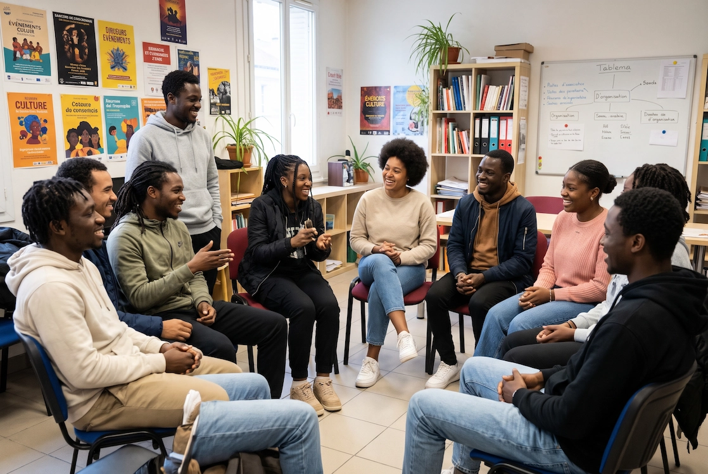

<!--
  ZONE DE CONTENU LIBRE (utile seulement si page_dediee: true).
  Écris ici la description longue, le programme, les infos pratiques.
  Tu peux utiliser du Markdown : **gras**, listes, liens, titres ##, etc.
  Si page_dediee est false, cette zone est ignorée.
-->

## 🌙 LE GRAND NDOGGOU DE L'ASA

> **L'ASA vous invite à sa rupture collective du jeûne. Un vrai moment de partage, de rencontres intergénérationnelles et d'accueil pour les étudiants.**

Dans l'esprit de solidarité du Ramadan, l'Association des Sénégalais d'Amiens organise son grand Ndoggou annuel. Cet événement se veut bien plus qu'un simple repas : c'est un espace de communion ouvert à toute personne souhaitant partager avec notre communauté, quelles que soient ses origines.

### 🗓️ Informations pratiques

* **Date :** Courant mars 2027 (Date exacte à venir)
* **Horaires :** À déterminer
* **Lieu :** Amiens (Lieu à confirmer)

*Les détails concernant les inscriptions ou la cagnotte solidaire seront communiqués très prochainement !*

**Venez nombreux, en famille ou entre amis, pour partager ce moment fort !**

